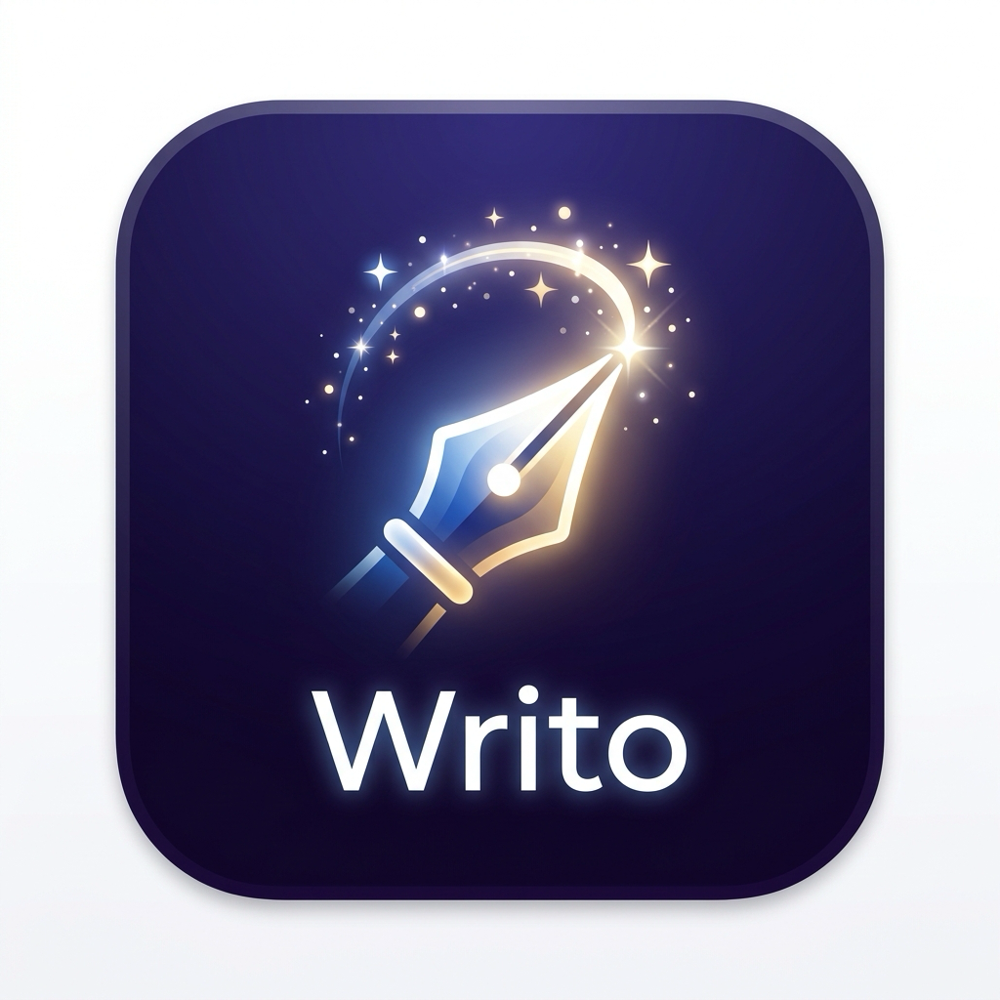

# Writo for Raycast (Slack & macOS Assistant)

> Polish, rewrite, fix grammar, and transform rough drafts instantly in Slack and any macOS app.



## Features

- **⚡ Quick Improve Selection (`quick-improve`)**:
  Highlight any draft in Slack, trigger your hotkey (e.g. `⌥ + Space` or `⌘ + ⇧ + I`), and Writo replaces the text in-place with a polished version. No copy-pasting required.
- **🎨 Rewrite & Tone Palette (`rewrite-palette`)**:
  Select text and choose your desired tone:
  - **Improve Writing**: Enhances clarity, flow, and quality.
  - **Professional Tone**: Elevates phrasing for executive and workplace communication.
  - **Make Concise**: Trims wordiness and cuts filler while preserving meaning.
  - **Fix Grammar**: Strictly corrects typos, syntax, and punctuation.
  - **Simplify**: Converts complex jargon into plain, clear English.
  - **Preview & Diff Mode** (`⌘ + P`): View before/after comparisons and word counts before replacing.
- **📝 Scratchpad (`scratchpad`)**:
  A floating composer to draft announcements or sensitive messages with custom instructions before pasting directly into Slack.

---

## Prerequisites & Installation

### 1. Install Raycast
If you haven't already, install [Raycast for macOS](https://www.raycast.com/) (free).

### 2. Install Project Dependencies
In this directory:
```bash
npm install
```

### 3. Run in Development Mode
To load the extension into Raycast:
```bash
npm run dev
```
Raycast will immediately detect the extension and make the commands available in your Raycast search bar.

---

## AI Backend Configuration

Writo supports both **100% Free & Offline Local AI** via Ollama and **Cloud APIs**.

### Option A: Local & Offline via Ollama (Default & Recommended)
Ollama is already installed on your Mac at `/usr/local/bin/ollama`.

1. Open Terminal and start Ollama (if not already running):
   ```bash
   ollama serve
   ```
2. Pull a lightweight model (recommended for Apple Silicon speed):
   ```bash
   ollama run llama3.2
   ```
   *(Alternative fast models: `qwen2.5:3b`, `mistral`, or `phi3`)*.

3. In Raycast, go to **Settings (⌘ + ,) $\rightarrow$ Extensions $\rightarrow$ Writo**:
   - Provider: **Ollama (Local & Free)**
   - Ollama Host: `http://localhost:11434`
   - Ollama Model: `llama3.2`

### Option B: Cloud API (OpenAI / Gemini)
1. In Raycast Preferences for Writo, change **AI Backend** to **Google Gemini API** or **OpenAI Compatible API**.
2. Enter your API key.

---

## Recommended Keyboard Hotkeys in Slack

To get the most seamless workflow in Slack, assign Raycast Hotkeys:
1. Open Raycast $\rightarrow$ Press `⌘ + ,` to open **Settings**.
2. Go to **Extensions** $\rightarrow$ **Writo**.
3. Set hotkeys:
   - **Quick Improve Selection**: `⌥ + ⇧ + I`
   - **Writo: Polish & Rewrite**: `⌥ + ⇧ + W`

### Typical Workflow:
1. Type a draft in any Slack channel or thread.
2. Select the text (or `⌘ + A`).
3. Press `⌥ + ⇧ + I` $\rightarrow$ Writo replaces the text instantly with the polished draft!
